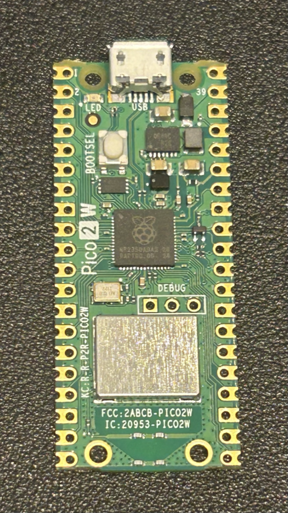

# Omnistik — O Joystick Universal

Atualizado em 29/10/2026. Síntese das decisões e hipóteses discutidas; não representa hardware ou firmware já validado.

## Objetivo
Criar um gateway que receba controles diferentes (USB, Bluetooth e controles 2,4 GHz com dongle) e os apresente a sistemas de destino. Primeiro alvo: **PlayStation 5 desbloqueado**, entregando os controles como joysticks de PS5, sem abrir ou modificar os controles de origem.

**Console bloqueado está fora de escopo.** Não há reprodução de autenticação nem empréstimo de credencial por dongle: o caminho assumido é o console desbloqueado, com payload neutralizando a autenticação. Isso reduz o problema a "entregar input ao sistema", que é o que este projeto resolve.

## Escopo V1
O V1 é desenvolvido e validado no **PS5 desbloqueado**, onde a autenticação é neutralizada por payload.

- Demonstrar **um gamepad de terceiros controlando o PS5**; depois expandir a dois e a quatro jogadores.
- O gateway emula um controle comum (XInput/HID) via USB nativo.
- Entrada dos controles físicos por **hub USB alimentado**, ligado à porta host.
- Controles de origem mantidos intactos.
- Sem dongle de autenticação — não existe fase 2 neste escopo.

## Hardware considerado



*Placa já em mãos para o protótipo: Raspberry Pi Pico 2 W, RP2350, `FCC: 2ABCB-PICO2W` / `IC: 20953-PICO2W`.*

- Raspberry Pi **Pico 2 W** (RP2350), candidato ao gateway.
- **Hub USB alimentado** (sem backfeed) concentrando os controles na porta host.
- Interface USB Host por PIO-USB — a porta do hub. Detalhes de fiação e testes em [docs/hardware.md](docs/hardware.md).
- PS5 **desbloqueado**: único alvo, recebe o gateway e o payload.
- Eventual transceptor 2,4 GHz externo, **modelo ainda não escolhido**.
- Ferramentas úteis: multímetro e analisador lógico.

## Arquitetura desejada
```text
Controles USB / dongles 2,4 GHz / Bluetooth
                   |
                   v
        hub USB alimentado (sem backfeed)
                   |
                   v
      porta host PIO-USB
                   |
                   v
            MultiController
              (Pico 2 W)
         emula controle XInput/HID
                   |
         USB nativo (device)
                   |
                   v
      cabo USB único
                   |
                   v
      PS5 desbloqueado (alvo)
```

**Um hub só.** Todos os controles compartilham a mesma porta host; o PS5 enxerga apenas o gateway. Fiação, lista de material e ordem de testes: [docs/hardware.md](docs/hardware.md).

## Estrutura do código

```text
src/
  core/            estado normalizado do controle — C puro, sem Pico SDK
  adapters/
    input.h        porta: de onde os controles chegam
    output.h       porta: onde os controles são apresentados
    synthetic/     fonte simulada (bancada, onda 1)
    ps5-pico/      saída USB composta que o PS5 enxerga
    bluepad32/     entrada Bluetooth (onda 5)
    pio-usb/       entrada USB host (trilha do hub)
  app/             composition root: init de placa, log e escolha da variante
test/              testes do que está em src/, rodando no host, sem placa
spikes/            experimentos de bancada, descartáveis, um alvo de build cada
```

Regras:

- **`core/` não conhece hardware.** Nada de Pico SDK, USB ou rádio — é o que permite testar no host.
- **`src/` é o código final; `test/` é onde ele é testado.** Enquanto a sonda for experimento, ela vive em `spikes/`; só sobe para `src/` o que sobreviver à medição.
- **`adapters/` tem as portas e as implementações.** Os arquivos `.h` na raiz de `adapters/` são os contratos; cada pasta filha é uma implementação concreta, com alvo de CMake próprio, que depende da porta e do Pico SDK.
- **`app/` é o único lugar que monta as peças** e sabe qual variante está sendo compilada (entrada simulada vs. Bluetooth, N controles).
- **`spikes/` é descartável.** Cada experimento é um firmware inteiro e independente; não entra no build do produto.

A pasta `platform/` foi considerada e descartada: quem toca o Pico SDK são as próprias implementações de adaptador, e uma camada por cima só criaria um segundo lugar para inicializar periférico.

## Saída para o PS5: dois mecanismos
Com a autenticação neutralizada por payload, entregar input ao console desbloqueado tem dois caminhos:

| Caminho | Como funciona | O que limita |
|---|---|---|
| **USB composto** | O Pico enumera como um dispositivo com N interfaces HID de gamepad | O PS5 atribui jogador por dispositivo USB; é medir se N interfaces viram N jogadores |
| **Payload no console** | O Pico entrega um controle comum; o payload cria os controles virtuais via `scePadVirtualDeviceAddDevice` / `InsertData` / `DeleteDevice` | Depende de payload; o limite é o número de slots virtuais |

O caminho do payload é o que sustenta vários jogadores com um único Pico mesmo que o USB composto falhe — a referência pública (`PoorDS4` / GhostControl) trabalha com `MAX_SLOTS 4`. Os dois caminhos não se excluem: o Pico pode enumerar como um controle enquanto o payload cria os demais.

**O que o payload não faz sozinho:** o `Ariel` mostra que abrir o ScePad a partir de um payload retorna `0x809b0081`, e enviar input cru não basta. A criação de controle virtual passa pela API `scePadVirtualDevice*`, não por escrita direta na camada de input.


## Software livre candidato
- [GP2040-CE](https://github.com/OpenStickCommunity/GP2040-CE): referência de emulação de gamepad e do modo *auth passthrough*; verificar suporte a RP2350 (o projeto nasceu em RP2040).
- [OGX-Mini](https://github.com/wiredopposite/OGX-Mini): base candidata para receber/normalizar gamepads de entrada.
- [Pico-PIO-USB](https://github.com/sekigon-gonnoc/Pico-PIO-USB): implementação USB via PIO, necessária para a porta host do hub.
- [PoorDS4 / GhostControl](https://github.com/a-ddr/PoorDS4): referência do caminho de payload — cria controles virtuais no PS5 por `scePadVirtualDevice*`, com `MAX_SLOTS 4`.

## Pesquisa e incógnitas do PS5
- **Controles virtuais por payload**: quais argumentos `scePadVirtualDeviceAddDevice` aceita e como o input chega em 60 Hz sem latência perceptível.
- Quantas interfaces USB o Pico 2 W sustenta ao mesmo tempo: host do hub e device para o PS5.
- Se o **USB composto com N interfaces HID** vira N jogadores ou apenas um.
- Comportamento do console desbloqueado quando o payload e o dispositivo USB descrevem o mesmo jogador.
- Latência, reconexão e suspensão do console ao alternar entre os dois caminhos de saída.
- Quantos controles cabem atrás do hub de entrada sem comprometer o polling.

## Achados de bancada

Medições já feitas. O detalhe e a evidência de cada uma ficam em [docs/hardware.md](docs/hardware.md).

- **O Pico 2 W enumera como gamepad.** Dispositivo USB composto com uma interface HID; o macOS o registra como Game Pad (UsagePage 1 / Usage 5), com o descritor de relatório previsto.
- **`sleep_ms()` no laço principal impede a enumeração no RP2350.** Com pico-sdk 2.3.1 e GCC 14.3, o dispositivo simplesmente não aparece no host; trocando por `busy_wait_us_32()` ele enumera. O caminho de sono do RP2350 (alarme + `wfe`) tem histórico de problema, e a correção citada no SDK não se aplica a esta combinação. **Regra do projeto: nada de `sleep_ms`/`sleep_us` no laço do firmware** até uma versão confirmada.

## Experimentos
1. **Pico como device**: enumerar como controle HID no PC.
2. **Pico como host**: ler um gamepad via PIO-USB.
3. **Host + device simultâneos**: ler o gamepad enquanto enumera no PC.
4. **PS5 desbloqueado aceita o Pico** como controle e responde ao input.
5. **Hub alimentado** com um gamepad, lido pelo Pico e repassado ao PS5 (P1).
6. **Latência e reconexão** ao desconectar/reconectar o controle de origem.
7. **Segundo controle** e enumeração P1/P2.
8. **Dispositivo composto com 4 interfaces HID**: verificar se o PS5 registra 4 jogadores. Se sim, um só Pico atende todos.
9. **Payload de controle virtual**: criar 4 controles por `scePadVirtualDevice*` e medir input, latência e quantos jogadores o console aceita.
10. **Conexão Bluetooth**: parear 4 controles no Pico com Bluepad32 e medir consumo, latência e estabilidade da pilha.

## Quatro jogadores com um Pico
A entrada não é o problema: Bluepad32 recebe até **4 controles Bluetooth** simultâneos no Pico 2 W, com a lista completa (DS4, DualSense, Switch Pro, Xbox). O gargalo é a saída — o PS5 atribui jogador **por dispositivo USB**, e o RP2350 tem um único controlador USB.

**Teste decisivo:** o Pico enumerar como **dispositivo composto com 4 interfaces HID de gamepad**. É barato e define toda a arquitetura.

| Resultado | Consequência |
|---|---|
| O PS5 registra 4 jogadores | **Um Pico resolve o objetivo inteiro** pelo USB |
| O PS5 registra 1 jogador | Um Pico basta, mas a saída é por payload (controles virtuais) |

Se os dois falharem, as formas viáveis são:

| Formato | Custo aprox. | Como |
|---|---|---|
| **1 cérebro + 4 bocas** | R$ 160 | Um Pico recebe os 4 BT e alimenta 4 RP2040 Zero por SPI/UART, cada um virando um joystick |
| **4 Picos**, um por jogador | R$ 240 | Cada placa faz 1 BT + 1 USB; simples e robusto |

**Payload faz parte do produto.** O caminho `ps5-unlock-pico` usa payload no console de forma assumida: o Pico entrega input comum e o payload do console cria os controles virtuais. Não há veto a payload — o que existe é a consequência de que esse caminho só roda em console desbloqueado, que é o único alvo do projeto.

## Mapeamento mínimo PS5
| Entrada genérica | Saída (controle emulado) |
|---|---|
| Direcional | D-pad |
| Analógico esquerdo | Left Stick |
| Analógico direito | Right Stick |
| Botão principal | Cross |
| Botões secundários | Circle / Square / Triangle |
| Botões de ombro | L1 / R1 |
| Gatilhos | L2 / R2 |
| Cliques dos analógicos | L3 / R3 |
| Menu / pausa | Options / Create |

## Critérios de sucesso do V1
- Um gamepad não PlayStation funciona em um **jogo de PS5** no console **desbloqueado**, **sem dongle**.
- Pipeline estável: enumeração, input e reconexão reproduzíveis.
- Latência adequada para jogar, medida em testes.
- Nenhuma modificação nos controles de origem.
- Escalável a quatro jogadores por um dos dois caminhos de saída, definido por medição.

## Evolução posterior
- Dois e quatro jogadores simultâneos.
- Alvo **Atari Pac-Man Edition** com os receptores DB9 dos CX40+ Wireless (fase posterior; ver histórico no git).
- Entradas de aproximadamente duas dezenas de controles diferentes.
- Saídas adicionais para Mac e Nintendo Switch 1 via USB.
- Perfis por controle e console, seleção automática e integração ao painel retrô PolyConsole.

## Decisões pendentes
- **Firmware e payload do console desbloqueado** — fixar versão como bancada oficial do projeto.
- Caminho de saída para múltiplos jogadores: USB composto ou controles virtuais por payload.
- Capacidade real do Pico 2 W com host USB (PIO) e device simultâneos.
- Quantidade de controles suportada atrás do hub de entrada.
- Estratégia de alimentação e proteção elétrica.

## Licença

[MIT](LICENSE) © 2026 Sandro Bihaiko
